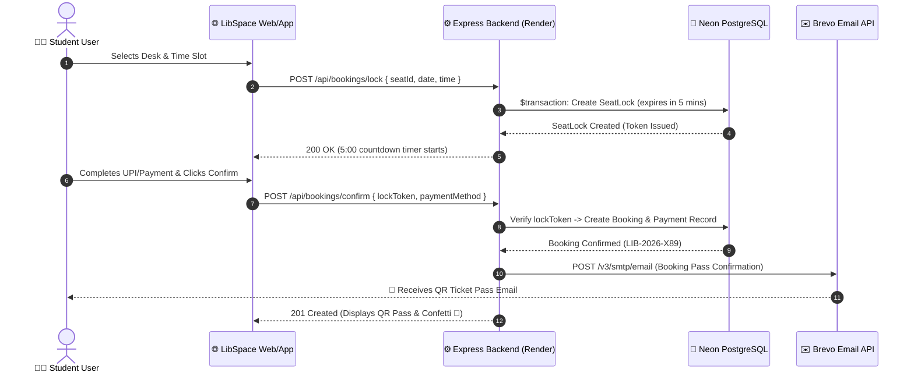

# 01. Architecture and Technology Stack

This document describes the high-level architecture, technology choices, project directories, and execution lifecycle of the **LibSpace** application.

---

## 1. Architectural Overview

LibSpace is designed as a decoupled, modern multi-tier full-stack application:

- **Client Presentation Tier:** A reactive Single Page Application (SPA) built using React 18, TypeScript, and Tailwind CSS. The same responsive frontend codebase powers both desktop web browsers and native Android devices via Capacitor 8.
- **Application & API Tier:** A high-throughput RESTful API built on Node.js and Express in TypeScript. It handles JWT authentication, transactional seat locking, cron cleanup routines, and multi-tenant role authorizations.
- **Persistence & Cloud Data Tier:** Managed serverless PostgreSQL hosted on Neon Cloud, interfaced through Prisma ORM 5.19 for type-safe queries, connection pooling, and automated schema migrations.
- **External Integration Tier:**
  - **Brevo (Sendinblue) Transactional API:** Dispatches registration OTPs, security PIN reset codes, booking confirmations, completion alerts, and refund notices strictly over IPv4.
  - **India Post API:** Provides instantaneous postal pincode autocompletion (city, district, state) during owner onboarding.

---

## 2. Complete Technology Stack

### Frontend Stack (Web & Mobile)

| Technology | Version | Purpose in LibSpace |
| :--- | :--- | :--- |
| **React** | `18.3.1` | Component-based UI framework for reactive rendering |
| **TypeScript** | `5.5.3` | Type-safety, compile-time error checking, and interface contracts |
| **Vite** | `5.4.3` | Blazing-fast build tool, HMR dev server, and production bundler |
| **Tailwind CSS** | `3.4.11` | Utility-first responsive CSS styling with custom brand colors |
| **React Router DOM** | `6.26.2` | Client-side routing for multi-page SPA navigation |
| **Axios** | `1.7.7` | HTTP client with automatic JWT token injection and 401 handling |
| **Lucide React** | `0.441.0` | Comprehensive library of modern, lightweight UI icons |
| **React Hot Toast** | `2.6.0` | Non-intrusive floating feedback notifications |
| **HTML5-QRCode** | `2.3.8` | In-browser and native device camera barcode & QR code scanner |
| **Canvas Confetti** | `1.9.3` | Micro-animation celebration upon successful booking confirmation |
| **Capacitor Core & CLI** | `8.6.0` | Native runtime bridge packaging web code into an Android APK |
| **Capacitor App** | `8.1.2` | Native Android hardware back-button listener and app lifecycle |
| **Capacitor Splash/Status** | `8.0.x` | Native dark-themed splash screen and status bar styling |

### Backend Stack (REST API & Automation)

| Technology | Version | Purpose in LibSpace |
| :--- | :--- | :--- |
| **Node.js** | `24.x` / `20.x` | High-performance asynchronous JavaScript/TypeScript runtime |
| **Express** | `4.21.0` | HTTP web server framework for REST routing and middleware |
| **TypeScript** | `5.6.2` | Static typing across all controllers, services, and models |
| **Prisma ORM** | `5.19.1` | Next-generation ORM with migrations, type generator, and studio |
| **PostgreSQL (Neon)** | `16.x` | Cloud serverless relational database with SSL pooling |
| **JSON Web Token (JWT)** | `9.0.2` | Stateless cryptographic authentication tokens (7-day validity) |
| **Bcryptjs** | `2.4.3` | One-way salt-hashed passwords and 6-digit owner security PINs |
| **Zod** | `3.23.8` | Schema validation for HTTP incoming payloads |
| **Morgan** | `1.10.0` | HTTP request logging for development and production debugging |
| **QRCode** | `1.5.4` | Server-side QR pass data generation |
| **Nodemailer** | `10.0.1` | SMTP transport fallback alongside HTTP transactional dispatch |

---

## 3. Project Directory Structure

```
lib/
├── docs/                           # Comprehensive documentation suite
│   ├── README.md                   # Central documentation hub
│   ├── 01_ARCHITECTURE_...md       # This file
│   ├── 02_DATABASE_...md           # Prisma schema & ER diagram
│   ├── 03_AUTHENTICATION_...md     # Auth, OTP, single-session
│   ├── 04_USER_MODULE_...md        # Student discovery & bookings
│   ├── 05_OWNER_PORTAL_...md       # Library owners & branches
│   ├── 06_ADMIN_PANEL_...md        # Master admin & sub-admins
│   ├── 07_API_DOCUMENTATION.md     # REST endpoints catalog
│   ├── 08_MOBILE_APP_...md         # Capacitor Android APK
│   └── 09_DEPLOYMENT_...md         # Vercel, Render & Operations
│
├── frontend/                       # Client web & mobile workspace
│   ├── android/                    # Capacitor Android Studio native project
│   │   ├── app/                    # Android application module
│   │   │   ├── src/main/           # AndroidManifest.xml, java, assets, res
│   │   │   └── build.gradle        # Android build configurations & SDK 35
│   │   └── build.gradle            # Root Gradle configuration
│   ├── public/                     # Static assets served at domain root
│   │   ├── downloads/              # Hosted Android release APK file
│   │   ├── images/                 # Official LibSpace logos & brand icons
│   │   ├── favicon.ico             # Brand browser tab favicon
│   │   └── manifest.json           # Progressive Web App (PWA) manifest
│   ├── src/
│   │   ├── components/             # Reusable React UI components
│   │   │   ├── booking/            # Checkout modal, QR pass, countdown timer
│   │   │   ├── common/             # Navbar, Footer, AuthModal, ProfileModal
│   │   │   ├── library/            # Library discovery cards
│   │   │   ├── scanner/            # HTML5 camera QR scanner modal
│   │   │   └── seat/               # Interactive visual desk matrix
│   │   ├── constants/              # Standard amenities list & facilities
│   │   ├── context/                # AuthContext (state, tokens, single-session)
│   │   ├── lib/                    # Axios API client & production URL resolution
│   │   ├── pages/                  # Top-level route views
│   │   │   ├── HomePage.tsx        # Discovery, geo-search, landing preview
│   │   │   ├── LibraryDetailsPage.tsx # Desk map, time picker, reviews
│   │   │   ├── MyBookingsPage.tsx  # User active passes, history, attendance
│   │   │   ├── OwnerDashboardPage.tsx # Multi-branch portal, PIN lock, gate
│   │   │   └── AdminDashboardPage.tsx # Master & Sub-admin verification console
│   │   ├── types/                  # TypeScript interface declarations
│   │   ├── App.tsx                 # Root component, routing, hardware back handler
│   │   ├── main.tsx                # React DOM entry point
│   │   └── index.css               # Global Tailwind CSS directives
│   ├── capacitor.config.json       # Mobile app ID (com.libspace.app) & plugins
│   ├── package.json                # Frontend package dependencies & scripts
│   ├── tailwind.config.js          # Tailwind theme & plugin configurations
│   ├── tsconfig.json               # TypeScript compiler config
│   ├── vercel.json                 # Vercel SPA routing rewrite rules
│   └── vite.config.ts              # Vite bundler build config
│
└── backend/                        # Node.js Express REST API server
    ├── prisma/                     # Database ORM directory
    │   └── schema.prisma           # Complete relational database models
    ├── src/
    │   ├── config/                 # Environment variables & Prisma client instance
    │   ├── controllers/            # Request handlers for each business domain
    │   │   ├── admin.controller.ts # Platform KPI stats, moderation, sub-admins
    │   │   ├── auth.controller.ts  # Registration, OTPs, login, passwords
    │   │   ├── booking.controller.ts # Seat locking, checkout, cancellations
    │   │   ├── library.controller.ts # Public search, geo-filter, reviews
    │   │   ├── owner.controller.ts # Branch creation, PIN, gate check-in
    │   │   └── seat.controller.ts  # Real-time seat matrix availability
    │   ├── middlewares/            # Express middlewares
    │   │   ├── auth.middleware.ts  # JWT verification & role authorization
    │   │   ├── error.middleware.ts # Centralized HTTP exception handler
    │   │   └── validation.middleware.ts # Schema parsing
    │   ├── routes/                 # Express endpoint routes
    │   │   ├── admin.routes.ts     # Protected /api/admin endpoints
    │   │   ├── auth.routes.ts      # Public /api/auth endpoints
    │   │   ├── booking.routes.ts   # Protected /api/bookings endpoints
    │   │   ├── library.routes.ts   # Public /api/libraries endpoints
    │   │   ├── owner.routes.ts     # Protected /api/owner endpoints
    │   │   ├── seat.routes.ts      # Public /api/seats endpoints
    │   │   └── index.ts            # Master API router aggregating all modules
    │   ├── services/               # Reusable business logic services
    │   │   ├── booking-cleanup.service.ts # 30s cron for seat release & refunds
    │   │   ├── email.service.ts    # Brevo IPv4 transactional email templates
    │   │   └── seat-lock.service.ts# Atomic 5-min database transactional locks
    │   ├── utils/                  # Helper utilities
    │   │   ├── qr.utils.ts         # QR code data generators
    │   │   ├── time.utils.ts       # IST date/time parsing & duration math
    │   │   └── token.utils.ts      # JWT sign and verify helpers
    │   └── index.ts                # Server entry point & cron initializer
    ├── package.json                # Backend dependencies & build scripts
    └── tsconfig.json               # TypeScript server compiler config
```

---

## 4. End-to-End System Communication Flow


