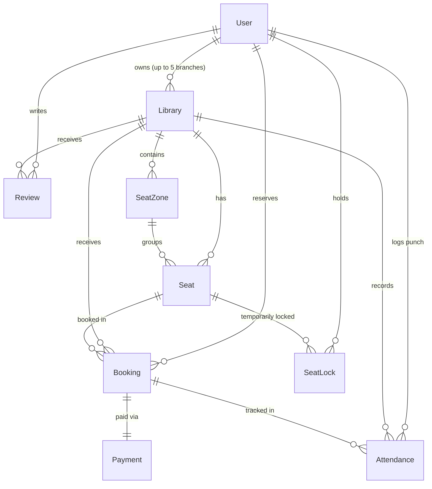

# 02. Database and Data Models

This document details the database architecture of LibSpace, powered by **Neon Cloud Serverless PostgreSQL** and mapped through **Prisma ORM**.

---

## 1. Entity-Relationship (ER) Diagram



---

## 2. Comprehensive Model Catalog

### 2.1. `User` Model
Stores accounts across all three platform roles: Students (`USER`), Library Owners (`OWNER`), and Administrators (`ADMIN`).

| Field Name | Type | Modifiers | Description |
| :--- | :--- | :--- | :--- |
| `id` | String | `@id @default(uuid())` | Primary unique key |
| `name` | String | - | Full name of the user or representative |
| `email` | String | `@unique` | Login email address (indexed) |
| `password` | String | - | Bcrypt-hashed password string |
| `phone` | String? | Optional | Contact mobile number |
| `role` | String | `@default("USER")` | `"USER"` \| `"OWNER"` \| `"ADMIN"` |
| `isApproved` | Boolean | `@default(true)` | False for new Library Owners until Admin approves |
| `approvalStatus` | String | `@default("APPROVED")` | `"APPROVED"` \| `"PENDING"` \| `"REJECTED"` |
| `otp` | String? | Optional | Temporary 6-digit login OTP |
| `otpExpiresAt` | DateTime? | Optional | OTP expiry window (10 minutes) |
| `resetToken` | String? | Optional | Password reset token |
| `resetTokenExpiresAt`| DateTime? | Optional | Password reset token expiry |
| `avatar` | String? | Optional | Profile image URL |
| `activeToken` | String? | Optional | Stores active JWT token to enforce single-device login |
| `securityPin` | String? | Optional | Bcrypt-hashed 6-digit PIN for Owner branch access |
| `pinResetOtp` | String? | Optional | 6-digit OTP for resetting Owner security PIN |
| `pinResetExpiresAt` | DateTime? | Optional | PIN reset OTP expiry (10 minutes) |
| `adminType` | String? | `@default("MASTER_ADMIN")` | `"MASTER_ADMIN"` \| `"SUB_ADMIN"` |
| `assignedState` | String? | Optional | State managed by Sub-Admin (e.g., `"Uttar Pradesh"`) |
| `createdAt` | DateTime | `@default(now())` | Account registration timestamp |
| `updatedAt` | DateTime | `@updatedAt` | Last profile update timestamp |

---

### 2.2. `EmailVerification` Model
Enforces email authenticity before account creation.

| Field Name | Type | Modifiers | Description |
| :--- | :--- | :--- | :--- |
| `id` | String | `@id @default(uuid())` | Primary unique key |
| `email` | String | `@unique` | Email address pending verification |
| `otp` | String | - | 6-digit verification code generated by server |
| `verified` | Boolean | `@default(false)` | Marked `true` once user enters valid code |
| `expiresAt` | DateTime | - | Verification window (10 minutes) |
| `createdAt` | DateTime | `@default(now())` | Dispatch timestamp |

---

### 2.3. `Library` Model
Represents a physical study hall or library branch.

| Field Name | Type | Modifiers | Description |
| :--- | :--- | :--- | :--- |
| `id` | String | `@id @default(uuid())` | Internal UUID primary key |
| `lid` | String? | `@unique` | Human-readable identifier (e.g. `"LID-101"`) |
| `name` | String | - | Official library name |
| `slug` | String | `@unique` | URL-safe slug for web routing |
| `tagline` | String? | Optional | Brief marketing headline |
| `description` | String | - | Full library description & rules |
| `address` | String | - | Street address |
| `city` | String | - | City name (indexed) |
| `district` | String? | Optional | District name |
| `state` | String | - | State name (indexed) |
| `pincode` | String | - | 6-digit postal code |
| `latitude` | Float | - | GPS latitude for proximity sorting |
| `longitude` | Float | - | GPS longitude for proximity sorting |
| `photos` | String | - | JSON string array of gallery photo URLs |
| `bannerImage` | String? | Optional | Primary exterior / front banner image URL |
| `interiorImage` | String? | Optional | Study hall / desk seating area image URL |
| `amenitiesImage` | String? | Optional | Facilities / amenities / cafeteria image URL |
| `facilities` | String | - | JSON string array (e.g. `["AC", "WiFi", "Sockets"]`) |
| `hourlyRate` | Float | - | Base hourly reservation fee in INR (₹) |
| `dailyRate` | Float? | Optional | Daily pass rate in INR (₹) |
| `monthlyRate` | Float? | Optional | Monthly membership fee in INR (₹) |
| `yearlyRate` | Float? | Optional | Annual VIP membership fee in INR (₹) |
| `enableMembership` | Boolean | `@default(true)` | Global pass toggle for this library |
| `enableMonthly` | Boolean | `@default(true)` | Monthly pass availability toggle |
| `monthlyDetails` | String? | Optional | Terms & privileges of monthly pass |
| `enableYearly` | Boolean | `@default(true)` | Yearly pass availability toggle |
| `yearlyDetails` | String? | Optional | Terms & privileges of yearly pass |
| `taxPercent` | Float | `@default(0)` | Configurable GST/tax percentage |
| `serviceFee` | Float | `@default(0)` | Fixed service fee in INR (₹) |
| `extraChargesDesc`| String? | `@default("Service...")`| Description of tax/fee on checkout bill |
| `hourlySeats` | Int | `@default(10)` | Desks allocated for flexible hourly booking |
| `monthlySeats` | Int | `@default(5)` | Desks reserved exclusively for Monthly passes |
| `yearlySeats` | Int | `@default(5)` | Desks reserved exclusively for Yearly VIPs |
| `openingTime` | String | - | Opening hour (e.g., `"07:00"`) |
| `closingTime` | String | - | Closing hour (e.g., `"23:00"`) |
| `status` | String | `@default("PENDING")` | `"PENDING"` \| `"APPROVED"` \| `"REJECTED"` \| `"FORWARDED_TO_MASTER"` |
| `rejectionReason` | String? | Optional | Explanation sent to owner upon rejection |
| `forwardedToMaster`| Boolean| `@default(false)` | Flagged if Sub-Admin escalated to Master |
| `forwardReason` | String? | Optional | Context for escalation |
| `ownerId` | String | Foreign Key | References `User.id` (Cascade delete) |
| `totalSeats` | Int | `@default(0)` | Total desks configured across all zones |

---

### 2.4. `SeatZone` & `Seat` Models
Structure the visual floor plan of a library.

#### `SeatZone`
- `id`: UUID Primary Key
- `name`: Zone name (e.g., `"Silent Focus Zone"`, `"Discussion Bay"`, `"Executive AC Hall"`)
- `description`: Optional notes regarding zone conduct
- `libraryId`: Foreign Key referencing `Library.id`

#### `Seat`
- `id`: UUID Primary Key
- `seatNumber`: Desk identifier (e.g., `"S-01"`, `"B-12"`)
- `seatType`: `"STANDARD"` \| `"PREMIUM_ERGONOMIC"` \| `"PRIVATE_CUBICLE"`
- `category`: `"HOURLY"` \| `"MONTHLY"` \| `"YEARLY"`
- `hourlyPrice`: Custom seat pricing (or defaults to library hourly rate)
- `hasPowerSocket`: Dedicated electrical charging outlet available
- `hasLamp`: Dedicated reading LED lamp available
- `isAvailable`: Maintenance toggle (if `false`, seat cannot be booked)
- `libraryId`: Foreign Key referencing `Library.id`
- `seatZoneId`: Foreign Key referencing `SeatZone.id`

---

### 2.5. `SeatLock` Model (Atomic 5-Minute Hold Engine)
Guarantees zero double-booking during student checkout.

| Field Name | Type | Description |
| :--- | :--- | :--- |
| `id` | String | UUID Primary Key |
| `lockToken` | String | Cryptographic token provided to client to authorize payment |
| `seatId` | String | Seat held |
| `userId` | String | Student holding the desk |
| `date` | String | Reservation date (`YYYY-MM-DD`) |
| `startTime` / `endTime` | String | `HH:MM` time bounds |
| `startDateTime` / `endDateTime` | DateTime | Timestamp boundary for overlap collision detection |
| `expiresAt` | DateTime | Exactly `createdAt + 5 minutes` |
| `status` | String | `"ACTIVE"` \| `"RELEASED"` \| `"EXPIRED"` \| `"CONVERTED"` |

---

### 2.6. `Booking` & `Payment` Models

#### `Booking`
- `id`: UUID Primary Key
- `bookingCode`: Unique readable pass code (e.g., `"LIB-2026-X89"`)
- `userId`: Reserving student
- `libraryId`: Target library
- `seatId`: Assigned desk
- `durationHours`: Total duration in decimal hours (e.g., `3.5`)
- `seatAmount`: Base seat price
- `taxAmount`: Calculated GST amount
- `platformFee`: Service & platform charge
- `totalAmount`: Final payable amount in INR (₹)
- `status`: `"CONFIRMED"` \| `"CHECKED_IN"` \| `"COMPLETED"` \| `"CANCELLED"` \| `"EXPIRED_NOSHOW"`
- `bookingType`: `"HOURLY"` \| `"DAILY"` \| `"MONTHLY"` \| `"YEARLY"`
- `validUntil`: Validity expiry date for Monthly & Yearly passes
- `qrCode`: Base64 QR code data URL containing check-in signature
- `checkInTime`: Exact timestamp when student scanned in
- `reminder30Sent` / `reminder90Sent`: Flags preventing duplicate reminder emails
- `refundAmount`: Amount refunded to user if cancelled or no-show
- `refundStatus`: `"NONE"` \| `"PROCESSED_30_NOSHOW"` \| `"PROCESSED_50_CANCEL"`

#### `Payment`
- `id`: UUID Primary Key
- `bookingId`: Unique reference to `Booking.id`
- `amount`: Total transaction value
- `currency`: Default `"INR"`
- `paymentMethod`: `"UPI"` \| `"CARD"` \| `"NET_BANKING"`
- `transactionId`: Gateway reference ID (e.g., `"TXN-982341..."`)
- `platformCommission`: Commission kept by LibSpace platform
- `ownerEarnings`: Net balance credited to library owner
- `paymentStatus`: `"PAID"` \| `"REFUNDED"` \| `"REFUNDED_30_PERCENT"` \| `"FAILED"`

---

### 2.7. `Attendance` Model (1x Daily Gate Constraint)
Enforces authentic physical presence for long-term passes.

| Field Name | Type | Description |
| :--- | :--- | :--- |
| `id` | String | UUID Primary Key |
| `bookingId` | String | Associated pass ID |
| `userId` | String | Student attending |
| `libraryId` | String | Library attended |
| `date` | String | Local IST date string (`"YYYY-MM-DD"`) |
| `checkInTime` | DateTime | Gate scan timestamp |
| `passType` | String | `"MONTHLY"` \| `"YEARLY"` \| `"HOURLY"` \| `"DAILY"` |
| `seatNumber` | String? | Desk occupied |

> **Security Constraint:**
> ```prisma
> @@unique([bookingId, date])
> ```
> This compound unique constraint ensures at the database engine level that no student or pass can scan more than **once per calendar day**. Any duplicate scan on the same date throws a unique constraint violation, preventing pass sharing.

---

## 3. Database Indexes for High-Traffic Performance

To guarantee sub-100ms response times under thousands of simultaneous searches:
1. `User`: Indexed by `email` and `role`.
2. `Library`: Indexed by `city`, `state`, `status`, and `ownerId`.
3. `Seat`: Indexed by `libraryId` and `seatZoneId`.
4. `SeatLock`: Composite index on `[seatId, startDateTime, endDateTime]` for instantaneous collision validation.
5. `Booking`: Composite index on `[seatId, startDateTime, endDateTime]` and index on `userId`.
6. `Attendance`: Composite index on `[userId, libraryId, date]`.
