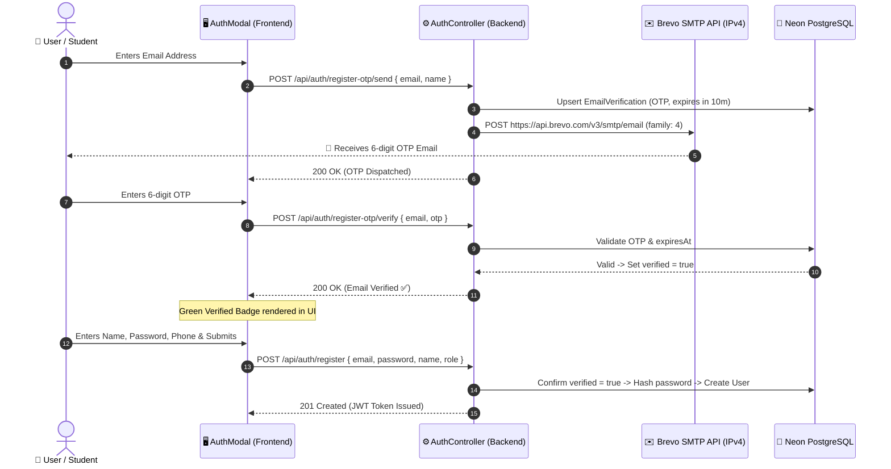
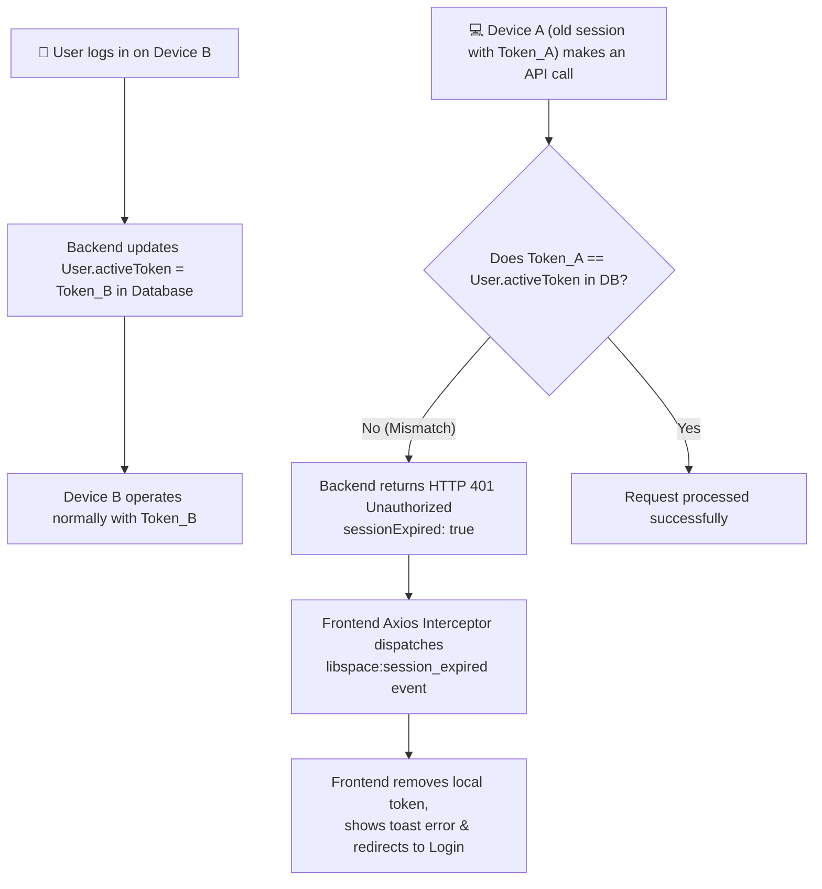
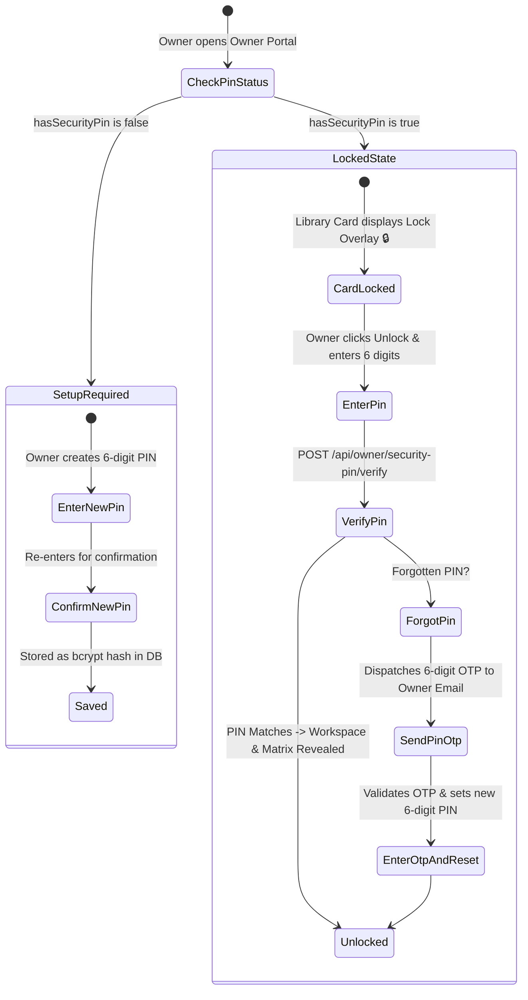

# 03. Authentication and Security

This document explains the security architecture, token lifecycle, email verification protocols, and multi-tenant access controls implemented in **LibSpace**.

---

## 1. Multi-Role Authorization Matrix

LibSpace defines three distinct user roles, with specialized sub-tiers for platform administration:

| Role | Access Scope | Approval Requirement | Default Path |
| :--- | :--- | :--- | :--- |
| **`USER`** | Students & study seekers. Can search libraries, hold seats, complete payments, view active QR passes, and track personal attendance. | Instant approval upon email verification | `/` (Home) |
| **`OWNER`** | Library owners and managers. Can add up to 5 library branches, manage 3-image showcases, configure desk matrices, view revenue analytics, and operate the live QR check-in gate. | Requires manual approval by Admin (`approvalStatus = "PENDING"`) | `/owner` |
| **`ADMIN`** (`MASTER_ADMIN`) | National platform administrator. Pan-India overview, manages state Sub-Admins, approves/rejects libraries, reviews all owners, and audits financial GMV. | Pre-seeded / root access | `/admin` |
| **`ADMIN`** (`SUB_ADMIN`) | State-level administrator (e.g. assigned to `"Uttar Pradesh"`). Scoped view of libraries and revenue within their assigned state; can approve, reject, or escalate to Master Admin. | Created by Master Admin | `/admin` |

---

## 2. Email OTP Registration with Brevo (Sendinblue)

To prevent fraudulent bot accounts and guarantee valid communication channels for tickets and refunds, LibSpace mandates email verification prior to account creation.



### Strict IPv4 Enforcement (`family: 4`)
Brevo security requires API calls to originate from whitelisted IP addresses. In cloud environments where dual-stack IPv4/IPv6 is active, outbound connections could alternate between IPv4 and IPv6, triggering security blocks.

In `backend/src/services/email.service.ts`, all Brevo requests explicitly enforce Node.js `family: 4`:
```typescript
const req = https.request({
  hostname: 'api.brevo.com',
  path: '/v3/smtp/email',
  method: 'POST',
  family: 4, // Strictly enforce IPv4 to match Brevo security whitelist
  headers: {
    'accept': 'application/json',
    'content-type': 'application/json',
    'api-key': ENV.BREVO_API_KEY,
  },
});
```

---

## 3. Single-Device Session Enforcement

To prevent account credential sharing among students or unauthorized concurrent access, LibSpace enforces **single-device active session tracking**.



### Implementation Details:
1. **Database Tracking:** The `User` model includes an `activeToken` column.
2. **On Successful Login:** The newly generated JWT token string is written directly to `User.activeToken`.
3. **On Every Authenticated Request:** The `authenticateUser` middleware decodes the JWT and queries PostgreSQL:
   ```typescript
   if (user.activeToken && user.activeToken !== token) {
     res.status(401).json({
       success: false,
       sessionExpired: true,
       message: 'Session Expired: You have logged in on another device.',
     });
     return;
   }
   ```
4. **Instant Client Reaction:** When Axios encounters a 401 response with `sessionExpired: true`, it broadcasts a window event:
   ```typescript
   window.dispatchEvent(new CustomEvent('libspace:session_expired', {
     detail: { message: 'Session Expired: Logged out because account was accessed on another device.' }
   }));
   ```
   The `AuthContext` catches this, clears `localStorage`, and warns the user with a red toast.

---

## 4. Owner 6-Digit Master Security PIN

A Library Owner on LibSpace can operate up to 5 branch locations under a single account. To prevent unauthorized staff or passersby from viewing sensitive revenue numbers or altering seat settings if the dashboard is left open, each branch workspace is locked behind a **6-Digit Security PIN**.



### PIN Security Highlights:
- **One-Way Encryption:** PINs are never stored in plain text; they are encrypted using `bcrypt.hash(pin, 10)`.
- **Session Memory:** When an owner unlocks a specific branch, its ID is stored in reactive frontend state (`unlockedLibraryIds`), maintaining accessibility during that browser session without re-prompting every minute.
- **Self-Service Recovery:** If forgotten, owners can click *"Forgot PIN?"* to receive a temporary 6-digit verification code at their registered email.

---

## 5. Password Security & Cryptography

- **Bcrypt Hashing:** User passwords undergo 10 salt rounds before database insertion.
- **JWT Signing:** JWTs are signed with a high-entropy secret (`JWT_SECRET`) using the `HS256` HMAC algorithm, valid for 7 days (`7d`).
- **Sanitized JSON Output:** User queries in Prisma systematically exclude the `password`, `otp`, `resetToken`, and `securityPin` fields from outgoing API responses.
