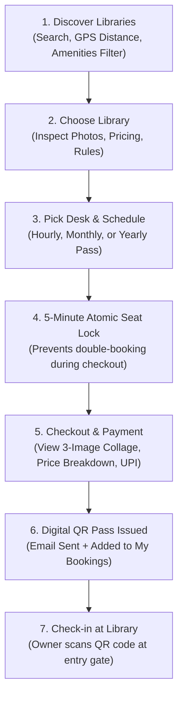
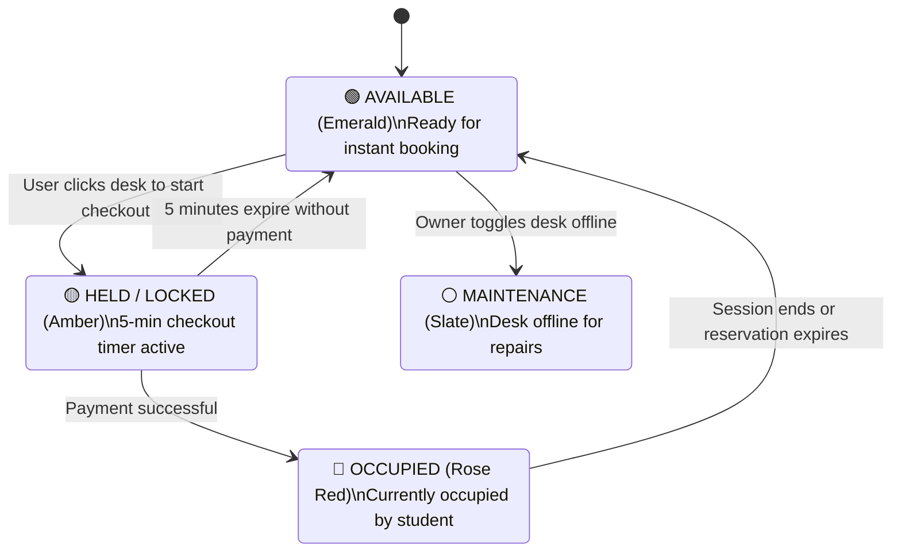

# 04. User Module and Booking Workflow

This document provides a detailed breakdown of the Student / Seeker experience on LibSpace, from library discovery to interactive seat booking, real-time locking, and QR code gate validation.

---

## 1. User Journey Overview

---

## 2. Library Discovery & Geolocation

The LibSpace home page (`frontend/src/pages/HomePage.tsx`) offers powerful search and discovery tools:

### Proximity & GPS Distance Calculation
- **Live GPS Mode:** The user can click *"Use My Live GPS Location"*. The browser's HTML5 Geolocation API retrieves the user's latitude and longitude.
- **Haversine Math:** The backend calculates the direct distance between the user's coordinates and the library coordinates in kilometers:
  $$d = 2R \arcsin\left(\sqrt{\sin^2\left(\frac{\Delta\phi}{2}\right) + \cos(\phi_1)\cos(\phi_2)\sin^2\left(\frac{\Delta\lambda}{2}\right)}\right)$$
- Libraries are automatically sorted by proximity, displaying badges like `📍 1.2 km away`.

### Multi-Faceted Filters
- **Search Query:** Matches against library name, address, city, district, or readable ID (`LID-101`).
- **Pass Type Filter:**
  - `ALL`: Displays every available study center.
  - `PASSES`: Shows only centers offering long-term Monthly or Yearly memberships.
  - `HOURLY`: Filters for centers supporting flexible hourly pay-as-you-study seats.
- **Max Price Slider:** Filters libraries by their hourly rate (e.g., up to ₹80/hr).
- **Amenities Checklist:** Filters by essential facilities such as *Air Conditioned*, *High-Speed WiFi*, *Power Sockets*, *Silent Study Zone*, *Cafeteria*, and *24/7 Access*.

---

## 3. Real-Time Seat Matrix & Category Allocations

On the Library Details page (`frontend/src/pages/LibraryDetailsPage.tsx`), users interact with a visual grid representation of the study hall:

### Visual Desk Status Indicators

### Dedicated Desk Categories
To ensure fairness for long-term members versus hourly visitors, libraries categorize desks:
1. **`HOURLY` Desks:** Reserved for flexible daily or hourly bookings.
2. **`MONTHLY` Desks:** Reserved exclusively for students purchasing a 30-day membership.
3. **`YEARLY` Desks:** Fixed, dedicated VIP desks reserved for annual pass holders.

If an hourly student attempts to click a Monthly pass desk, the UI prevents the action with an informative warning: `Desk A-04 is reserved for Monthly members. Please select an Hourly desk.`

---

## 4. The 5-Minute Atomic Seat Lock Engine

To prevent race conditions where two students simultaneously pay for the same desk, LibSpace uses a database-level atomic lock before initiating payment.

### How the 5-Minute Hold Works:
1. When a student clicks an available seat, the client calls `POST /api/bookings/lock`.
2. The backend opens a **Prisma database transaction** (`prisma.$transaction`).
3. It checks whether any existing booking or active `SeatLock` overlaps with the requested time window.
4. If clear, a new `SeatLock` record is created with:
   - A unique cryptographic `lockToken`.
   - `expiresAt = now + 5 minutes`.
   - `status = "ACTIVE"`.
5. The `SeatLockTimer` component renders a floating 5-minute countdown (`04:59... 04:58...`) on the checkout screen.
6. If the student completes payment within 5 minutes, the lock status becomes `"CONVERTED"`.
7. If the student closes the modal, the frontend immediately calls `POST /api/bookings/release-lock` to return the desk to `AVAILABLE`.
8. If the browser is abruptly closed, the background cron worker marks the lock as `"EXPIRED"` at minute 5, automatically freeing the desk.

---

## 5. Checkout Modal & 3-Image Showcase Collage

When the checkout modal (`BookingCheckoutModal.tsx`) opens, the student is presented with:

- **3-Image Visual Collage:** An image strip showcasing:
  1. *Exterior Banner* (Street front and entrance).
  2. *Interior Study Hall* (Quiet lighting and ergonomics).
  3. *Amenities & Desks* (Power sockets and study cubicles).
  This gives students complete confidence in the study environment before spending money.
- **Transparent Price Breakdown:**
  - Base Seat Fee: $\text{Rate} \times \text{Duration}$
  - Configurable GST / Tax: e.g., $18\%$ or as set by owner.
  - Platform & Maintenance Fee: Fixed platform service charge.
  - **Total Payable Amount in INR (₹).**
- **Payment Method Simulation:** Instant UPI (Google Pay, PhonePe, Paytm), Credit/Debit Card, or Net Banking.

---

## 6. Pass Management & Digital QR Code Tickets

Once confirmed, bookings appear in the student's **My Bookings** portal (`frontend/src/pages/MyBookingsPage.tsx`), organized into three tabs:

### 1. Active Bookings & Passes Tab
Displays current and upcoming sessions with:
- **High-Density QR Code Pass:** Encodes the secure booking verification payload (`LIB-2026-X89`).
- **Live Countdown Timer:** Shows remaining duration or pass validity.
- **Extend Booking Button:** Allows students to extend their hourly study session without leaving their seat if the desk is not booked by someone else for the next hour.
- **Cancel Booking Button:** Initiates voluntary cancellation with an immediate **50% refund**.

### 2. Daily Attendance Log Tab
For students with Monthly or Yearly passes, this tab displays an attendance punch calendar showing every date and time they checked in at the library.

### 3. Booking History Tab
An archive of past completed study sessions, receipt details, and records of processed refunds.

---

## 7. Automated Check-In Reminders & Fair Refund Policies

LibSpace enforces automated rules to protect both student money and library desk occupancy:

### 1. 30-Minute & 90-Minute Check-in Reminders
If a student books a desk but does not scan their QR code at the library front desk within 30 minutes of the start time, the background worker dispatches a gentle email reminder:
> *"🔔 Your booking started 30 minutes ago. Please remember to scan your QR pass at the front desk."*
If still unverified after 90 minutes, an urgent second notice is dispatched.

### 2. 30% No-Show Auto-Refund
If a student completely fails to attend and their session expires without any recorded check-in:
- The system automatically marks the booking as `EXPIRED_NOSHOW`.
- **30% of the total amount paid is refunded** to the student's original payment method.
- The remaining 70% is retained as a reservation holding fee for the library owner.
- The desk is immediately marked `AVAILABLE` for other walk-in students.
- An automated email breakdown is sent to the student explaining the no-show refund.

### 3. 50% Voluntary Cancellation Refund
Students who cancel an upcoming booking before session completion receive an **instant 50% refund**, with the desk made available for new bookings immediately.
