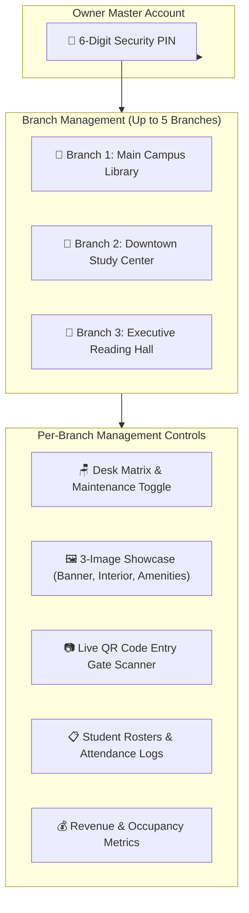
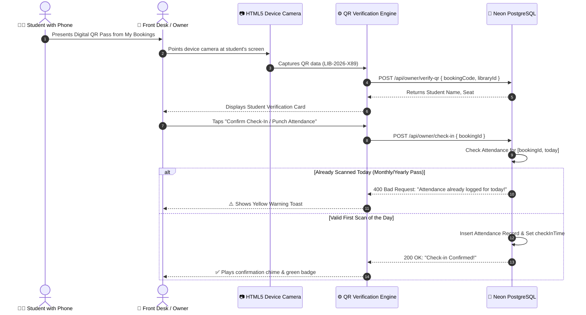

# 05. Owner Portal and Multi-Branch Management

This document provides a comprehensive operational manual for Library Owners using the **LibSpace Owner Dashboard** (`frontend/src/pages/OwnerDashboardPage.tsx`).

---

## 1. Owner Workspace Architecture



---

## 2. Multi-Branch Ownership (Up to 5 Branches)

LibSpace allows study hall entrepreneurs to expand their business across multiple neighborhoods or cities without creating separate accounts:
- **Unified Master Account:** One owner login can manage up to **5 distinct library branches**.
- **Independent Settings:** Each branch maintains its own address, pricing tiers, operating hours, desk layout, and photo showcases.
- **Quota Enforcement:** If an owner attempts to register a 6th branch, the system enforces a business boundary, preventing branch overload and guiding them to enterprise scaling support.

---

## 3. 6-Digit Master Security PIN Protection

To protect owner revenue figures and desk controls when devices are left unattended at a front desk:
- **Initial Setup:** On first access, owners are prompted to configure a 6-digit PIN.
- **Card-Level Lock:** Each branch card in the dashboard is displayed with a security lock overlay. Clicking *"Unlock Workspace"* reveals a numeric keypad modal.
- **Bcrypt Encrypted:** The PIN is hashed using `bcrypt` and verified on the server via `POST /api/owner/security-pin/verify`.
- **Email OTP Recovery:** If an owner forgets their PIN, clicking *"Forgot PIN?"* sends a 6-digit recovery OTP to their verified email address, allowing an instant reset.

---

## 4. Onboarding a New Library Branch

Adding a new study hall is streamlined through the **Add Library Modal**:

### 1. India Post Pincode Autocompletion
When the owner inputs a 6-digit postal pincode, LibSpace queries the postal directory API:
- Automatically fills **City**, **District**, and **State**.
- Populates a dropdown of **Available Localities** within that postal code.
- Reduces manual entry errors and ensures standardized regional filtering.

### 2. 3-Image Showcase Upload
Every listed library is required to feature three specialized photographs:
1. **Banner Image:** Exterior building entrance and street front.
2. **Interior Image:** Main study hall layout, air-conditioning, and ergonomic chairs.
3. **Amenities Image:** Dedicated study cubicles, power sockets, charging stations, or drinking water facilities.
- **In-Browser Validation:** Supports direct file upload via `FileReader` with client-side validation ensuring files stay within **5 MB**.

### 3. Operating Schedule & Capacity
- **Opening & Closing Times:** Configurable in 24-hour format (e.g., `07:00` to `23:00`).
- **Category Seat Allocation:**
  - *Hourly Desks:* e.g., 10 desks allocated for daily visitors.
  - *Monthly Desks:* e.g., 5 desks reserved for 30-day members.
  - *Yearly Desks:* e.g., 5 dedicated desks for annual VIPs.

### 4. Transparent Pricing & Membership Tiers
- **Hourly Base Rate:** e.g., ₹40/hour.
- **Monthly Membership Pass:** e.g., ₹1,200/month with custom inclusions.
- **Yearly VIP Pass:** e.g., ₹12,000/year with locker privileges.
- **Taxes & Service Fees:** Configurable GST percentage (e.g. 18%) and custom fee descriptions.

---

## 5. Visual Desk Matrix & Maintenance Mode

Owners can view and manage their physical floor plan in real time:

- **Adding Desks:** Owners can create individual desks specifying:
  - Desk Number (e.g., `Desk A-01`).
  - Zone (e.g., *Silent Focus Zone*, *AC Deluxe Bay*).
  - Desk Type (*Standard*, *Premium Ergonomic*, or *Private Cubicle*).
  - Allocation Category (*Hourly*, *Monthly*, or *Yearly*).
  - Hardware Perks: Toggles for *Power Socket* and *Reading Lamp*.
- **One-Click Maintenance Toggle:** If a chair breaks or electrical wiring requires servicing, the owner clicks the desk's maintenance switch (`PATCH /api/owner/seats/:seatId/toggle`). The desk immediately turns slate gray (`MAINTENANCE`) across the platform, preventing student reservations until repaired.

---

## 6. Live QR Entry Gate Scanner & Attendance

LibSpace includes a built-in front desk scanner (`frontend/src/components/scanner/QRScannerModal.tsx`) eliminating paper registers:



### 1x Daily Scan Enforcement
For long-term monthly and yearly passes, LibSpace enforces a compound database unique constraint on `Attendance`:
```prisma
@@unique([bookingId, date])
```
If a student attempts to pass their phone to a friend to enter the library twice in one day, the database rejects the second check-in attempt with a duplicate punch error.

---

## 7. Student Rosters and Attendance Management

The Owner Dashboard provides a multi-tab student audit table:

1. **Daily Bookings Tab:** Real-time log of hourly students currently in the building, displaying seat numbers, time slots, check-in status, and paid revenue.
2. **Premium Passes Tab:** Roster of all active 30-day and 365-day pass holders, including validity expiry dates, pass codes, and total days attended.
3. **Attendance Logs Tab:** Complete historical timeline of all gate scans with exact timestamps, student names, and pass categories.
