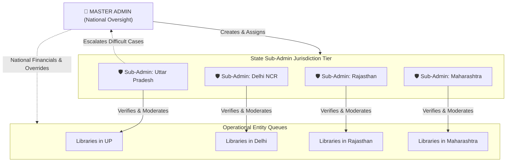
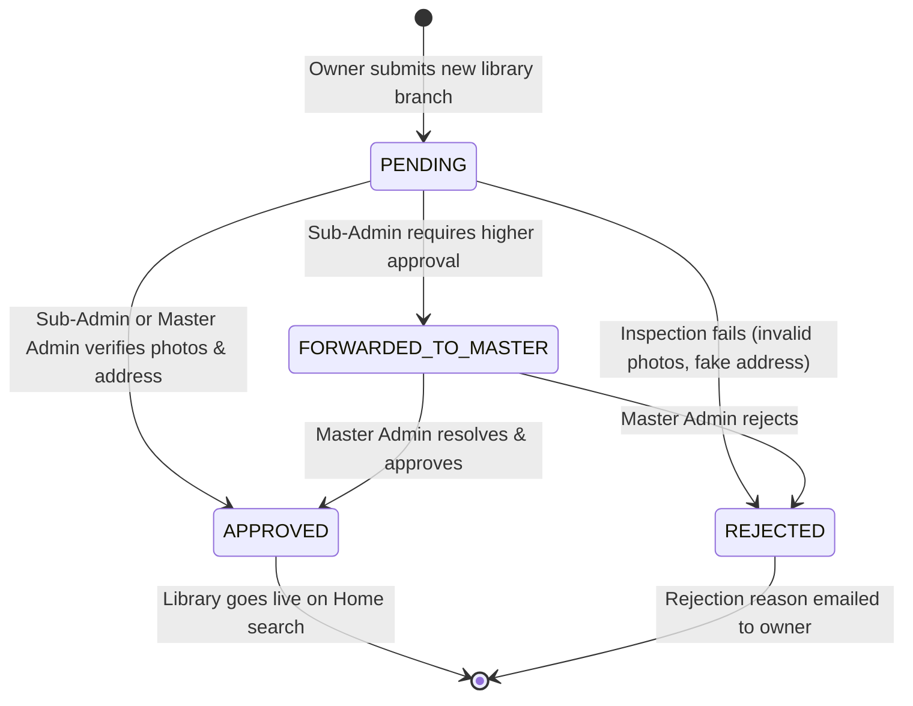

# 06. Admin Panel and Platform Governance

This document describes the governance structure, verification queues, state-level administration, and financial oversight tools available in the **LibSpace Admin Portal** (`frontend/src/pages/AdminDashboardPage.tsx`).

---

## 1. Administrative Hierarchy

---

## 2. Master Admin vs. State Sub-Admin Scopes

LibSpace implements strict role-based data partitioning within `backend/src/controllers/admin.controller.ts`:

| Capability | Master Admin | State Sub-Admin |
| :--- | :--- | :--- |
| **Data Scope** | Entire Country (Pan-India) | Scoped strictly to assigned state (e.g. `"Uttar Pradesh"`) |
| **Financial GMV & Commission** | National totals across all states | State-specific Gross Merchandise Value (GMV) & Commission |
| **Library Verification** | Can approve/reject any library nationwide | Can approve/reject libraries within their state |
| **Escalation Handling** | Resolves libraries forwarded by Sub-Admins | Can forward complex library applications to Master Admin |
| **Sub-Admin CRUD** | Can create, edit, reassign, and delete Sub-Admins | No access to Sub-Admin management |
| **Owner Moderation** | Can approve/reject owners nationwide | Can review owners operating in their state |
| **User Directory** | Can audit any student reservation nationwide | Can audit students with bookings in their state |

---

## 3. Financial & KPI Dashboard

The Admin Dashboard provides real-time financial tracking:

### Key Metrics Tracked
- **Gross Merchandise Value (GMV):** Cumulative revenue processed through the platform in INR (₹).
- **Platform Commission Earned:** Net revenue earned by LibSpace from service charges and platform fees.
- **Total Approved Libraries & Desks:** Active inventory available for public reservations.
- **Pending Approvals Queue:** Study halls awaiting verification.
- **Registered Student Base:** Total verified student accounts, categorized into users with active reservations vs. prospective browsers.

### State-Level Breakdown Matrix
For the Master Admin, the overview includes an interactive state distribution chart highlighting top-performing geographic markets (e.g., *Uttar Pradesh*, *Delhi*, *Rajasthan*, *Maharashtra*).

---

## 4. Library Verification & Moderation Queue

Every study hall listed by an owner must pass administrator verification before it appears in public search results.

### Reviewer Checklist:
When reviewing an application in the **Verification Queue** (`activeTab === 'queue'`), admins evaluate:
1. **3-Image Showcase Quality:** Ensures banner, interior seating, and desk amenities photos are genuine, high-resolution, and un-stretched.
2. **Address & Pincode Accuracy:** Verifies physical existence in the stated city and district.
3. **Desk Allocation Fairness:** Confirms the ratio between Hourly, Monthly, and Yearly desks aligns with hall capacity.
4. **Action Options:**
   - **Approve:** Library status transitions to `APPROVED`; immediately live for student bookings.
   - **Reject:** Admin supplies a mandatory rejection explanation sent directly to the owner.
   - **Forward to Master:** If a Sub-Admin encounters licensing questions or special requests, they can escalate the library with a custom reason to the Master Admin's priority queue.

---

## 5. Sub-Admin Management (Master Admin Only)

Under the **Sub-Admins** tab (`activeTab === 'subadmins'`), the Master Admin manages the state administration team:

- **Create Sub-Admin:** Assigns a representative name, email, password, and designated state jurisdiction (e.g., *"Uttar Pradesh"*).
- **Edit & Reassign:** Ability to transfer a Sub-Admin's jurisdiction or update credentials.
- **Delete Sub-Admin:** Revokes administrative privileges instantly.

---

## 6. Owner Moderation & Onboarding

Under the **Owners** tab (`activeTab === 'owners'`), administrators review entrepreneurs who registered as library partners:
- **Pending Verification:** Owners cannot list libraries until their identity is verified.
- **Branch Fleet Auditing:** Displays how many branches each owner currently manages (0 to 5 branches).
- **Approval Dispatch:** Approving an owner triggers an automated confirmation email with a direct login button to the Owner Portal.

---

## 7. User Management and Reservation Auditing

Under the **Users** tab (`activeTab === 'users'`), administrators can inspect student activity across the platform:
- **Searchable Student Directory:** Filter students by name, email, or telephone number.
- **Total Bookings & Spend:** View total reservations completed and total amount spent in INR (₹).
- **Reservation History Drawer:** Clicking any student reveals their complete historical booking ledger, including dates, desk numbers, pass codes, check-in timestamps, and refund receipts.
