# 08. Android Mobile App and PWA Architecture

This document describes the native Android packaging and Progressive Web App (PWA) architecture of **LibSpace**.

---

## 1. Native Mobile Overview

Rather than a temporary wrapper or browser shortcut, LibSpace is packaged as a genuine, installable Android APK powered by **Capacitor 8**:

```mermaid
flowchart LR
    WebSrc["Vite React Source Code\n(frontend/src)"] --> ViteBuild["Vite Production Build\n(frontend/dist)"]
    ViteBuild --> CapSync["Capacitor Bridge Engine\n(npx cap sync android)"]
    CapSync --> AndroidStudio["Android Native Project\n(frontend/android)"]
    AndroidStudio --> Gradle["Gradle Build & SDK 35\n(:app:assembleRelease)"]
    Gradle --> Keystore["RSA 2048 Keystore Signing\n(libspace-release-key.jks)"]
    Keystore --> ReleaseAPK["📦 libspace-release.apk\n(14.4 MB Production APK)"]
```



### Application Specifications
- **App Name:** `LibSpace`
- **Application ID (Package Name):** `com.libspace.app`
- **Target Android SDK:** API Level 35 (Android 15)
- **Minimum Android SDK:** API Level 22 (Android 5.1 Lollipop)
- **APK Binary Size:** ~14.4 MB
- **Direct Download Link:** [https://library-booking-omega.vercel.app/downloads/libspace-release.apk](https://library-booking-omega.vercel.app/downloads/libspace-release.apk)

---

## 2. Official Brand Icons & Splash Screen

LibSpace features official branded graphics generated from the brand logo:

### 1. Launcher Mipmap Icons
Adaptive and round launcher icons are configured across all Android density buckets:
- `mipmap-mdpi` (48x48)
- `mipmap-hdpi` (72x72)
- `mipmap-xhdpi` (96x96)
- `mipmap-xxhdpi` (144x144)
- `mipmap-xxxhdpi` (192x192)

### 2. High-Performance Dark Splash Screen
On app launch, Capacitor displays a native dark-themed splash screen before the WebView initializes:
```json
"SplashScreen": {
  "launchShowDuration": 2000,
  "launchAutoHide": true,
  "backgroundColor": "#0f172a",
  "androidSplashResourceName": "splash",
  "androidScaleType": "CENTER_CROP"
}
```

---

## 3. Native Hardware Handlers & User Experience

### 1. Hardware Back-Button Listener
Standard web apps often close unexpectedly when users press the Android device back button. LibSpace solves this using `@capacitor/app`:
```typescript
CapApp.addListener('backButton', ({ canGoBack }) => {
  if (window.location.pathname !== '/') {
    window.history.back(); // Navigate to previous screen
  } else if (canGoBack) {
    window.history.back();
  } else {
    CapApp.exitApp(); // Gracefully minimize app from home screen
  }
});
```

### 2. Immersive Navigation
The application runs in **fullscreen standalone mode**:
- No browser address bars or URL inputs.
- Status bar color is permanently synced to dark navy (`#0f172a`).

### 3. Native Hardware Camera Scanning
When library owners scan student QR passes, the app accesses the physical camera via `@capacitor` permissions and HTML5 Video APIs, enabling instantaneous gate punch processing.

---

## 4. Release Keystore & Build Instructions

The APK is signed with a release keystore:
- **Keystore Path:** `frontend/android/app/libspace-release-key.jks`
- **Algorithm:** RSA 2048-bit with SHA-256 digest
- **Validity:** 10,000 days (~27 years)

### Steps to Rebuild the APK:
1. Build frontend web assets:
   ```powershell
   cd frontend
   npm run build
   ```
2. Sync web assets into native Android container:
   ```powershell
   npx cap sync android
   ```
3. Compile signed release APK using Gradle wrapper:
   ```powershell
   cd android
   ./gradlew assembleRelease
   ```
4. The generated APK resides at:
   `frontend/android/app/build/outputs/apk/release/app-release.apk`

---

## 5. Progressive Web App (PWA) Setup

For users who prefer not to download the APK, LibSpace also functions as a Progressive Web App:
- **Manifest:** Configured at `frontend/public/manifest.json`.
- **Install App Button:** Strictly located in the website **footer** to maintain a clean landing page layout.
- Clicking *"Install App"* triggers the native browser prompt (`beforeinstallprompt`) on desktop Chrome, Edge, and Android Chrome.
