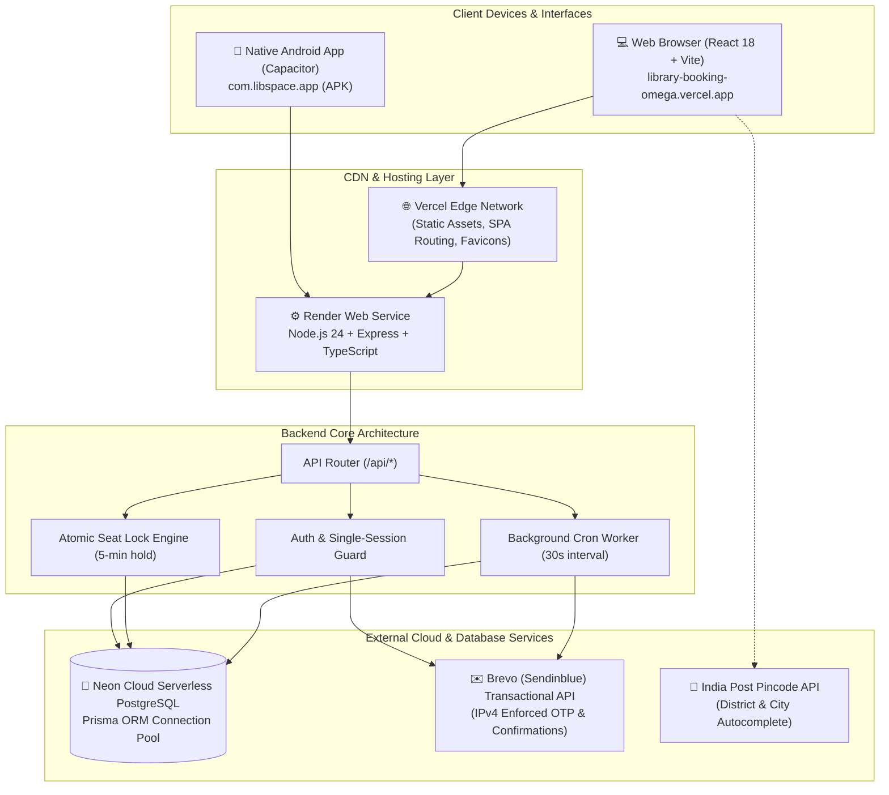

# 📚 LibSpace — Complete Website & Platform Documentation

Welcome to the official technical documentation for **LibSpace**, an enterprise-grade, decentralized library seat and private study desk booking platform.

This documentation has been thoroughly prepared by analyzing every source file, database model, API controller, and UI component in the codebase. It provides a complete, easy-to-understand reference for developers, owners, administrators, and stakeholders.

---

## 🌟 Quick Project Links & Live Deployments

| Component | Provider / Platform | Production URL |
| :--- | :--- | :--- |
| **Frontend Web App** | Vercel (Vite + React SPA) | [https://library-booking-omega.vercel.app/](https://library-booking-omega.vercel.app/) |
| **Backend API** | Render (Node.js + Express) | [https://library-booking-49tt.onrender.com](https://library-booking-49tt.onrender.com) |
| **API Health Check** | Render 24/7 Ping Endpoint | [https://library-booking-49tt.onrender.com/api/health](https://library-booking-49tt.onrender.com/api/health) |
| **Cloud Database** | Neon Serverless PostgreSQL | `postgresql://...neon.tech/neondb` (SSL enabled) |
| **Native Android APK** | Direct Download | [Download LibSpace APK](https://library-booking-omega.vercel.app/downloads/libspace-release.apk) |

---

## 📖 Documentation Directory Index

Explore the documentation across 9 focused guides:

1. [**01. Architecture & Technology Stack**](./01_ARCHITECTURE_AND_TECHNOLOGY_STACK.md)
   - High-level system architecture, component interaction diagram, technology stack, and full folder tree.
2. [**02. Database & Data Models**](./02_DATABASE_AND_DATA_MODELS.md)
   - Complete Entity-Relationship (ER) diagram, Prisma schema definitions, relationships, indexes, and constraints.
3. [**03. Authentication & Security**](./03_AUTHENTICATION_AND_SECURITY.md)
   - Brevo Email OTP verification, JWT single-device session enforcement, password hashing, and Owner 6-digit Security PIN.
4. [**04. User (Student) Module & Booking Workflow**](./04_USER_MODULE_AND_BOOKING_WORKFLOW.md)
   - Library search, GPS geo-distance, 5-minute atomic desk locking, QR code pass generation, attendance, and refunds.
5. [**05. Owner Portal & Multi-Branch Management**](./05_OWNER_PORTAL_AND_BRANCH_MANAGEMENT.md)
   - Multi-branch library listing (up to 5 branches), 3-image showcase uploads, postal pincode lookup, QR pass gate scanner, and attendance logs.
6. [**06. Admin Panel & Platform Governance**](./06_ADMIN_PANEL_AND_GOVERNANCE.md)
   - Master Admin vs. State Sub-Admin hierarchy, state-scoped verification queue, escalating libraries, and owner/user moderation.
7. [**07. Complete API Documentation**](./07_API_DOCUMENTATION.md)
   - Complete REST API specification detailing endpoints, headers, payload examples, and status codes.
8. [**08. Android Mobile App & PWA**](./08_MOBILE_APP_AND_PWA.md)
   - Capacitor 8 native Android setup, keystore signing, launcher icons, splash screen, and PWA manifest.
9. [**09. Deployment, DevOps & Operations**](./09_DEPLOYMENT_DEVOPS_AND_OPERATIONS.md)
   - Step-by-step production hosting on Vercel & Render, environment variable catalog, and 24/7 keep-alive automation.

---

## 🏛️ High-Level System Architecture Diagram

---

## 💡 Key Architectural Highlights

- **Anti-Double-Booking Guarantee:** When a student selects a desk, LibSpace executes an atomic 5-minute transactional hold (`SeatLock`) in PostgreSQL. Other users immediately see the desk as locked with a live countdown timer.
- **Fair Refund Policies:**
  - **No-Show Protection:** If a student does not check in before their booking ends, the desk is automatically released back to the public and a 30% refund is initiated.
  - **Voluntary Cancellation:** Students can cancel upcoming bookings directly from their dashboard with an immediate 50% refund.
- **Master Admin & State Sub-Admin Hierarchy:** Platform administration supports state-level delegation. A Sub-Admin for "Uttar Pradesh" only verifies libraries and monitors revenue within UP, with the ability to escalate complex requests to the Master Admin.
- **Multi-Branch Owner Security:** A single library owner can manage up to 5 branch locations under one master account, secured by a dedicated 6-digit numeric PIN.
- **Real-Time Attendance Gate:** For monthly and yearly passes, students scan their QR code at the library front desk. The system enforces a database-level constraint allowing strictly 1 punch per pass per calendar date.
